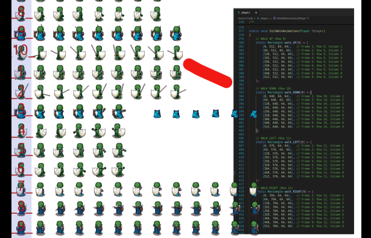

# Animated FSM Command Pattern StarterKit Guide

This _StarterKit_ is the starting point for your project. It's a [raylib](https://www.raylib.com/) game in C that brings together everything from the practicals: an [**Animated Finite State Machine (FSM)**](https://www.codeproject.com/articles/State-Machine-Design-in-C#comments-section), command-based input, a mediator, [collision detection](https://github.com/RandyGaul/cute_headers/blob/master/cute_c2.h) with cute_c2, and sprite-sheet animation. A player and an NPC fight it out with swords, and the FSM decides what each of them can do at any moment.

It's designed for learning core game development patterns: event handling, state transitions, animated sprites and game object management. Your job is to turn it into your own game.

_StarterKit_ provides:

- A Finite State Machine (FSM) for player and NPC behaviour, driven by transition tables
- The Command pattern for input, for the player and the AI alike
- One Mediator that passes commands on, and tells the HUD and audio what happened in the game
- Sprite-sheet animations, set up when each state starts
- Circle-based collision detection, with collision events sent to the FSM
- Sword damage on the frame the blade lands, recovery after every swipe, and shield blocking
- A HUD with a game-over banner, action sounds, a backing track, and a new background every game

> The project was generated with [raylib project creator](https://raysan5.itch.io/raylib-project-creator) by raysan5.

---

## Short version

If you just want to get going, this is the whole thing in a few lines:

**1. Clone**

```bash
mkdir -p ~/Projects
cd ~/Projects
git clone https://github.com/MuddyGames/GPPI_project
```

**2. Set up raylib**

*Linux:*

```bash
cd ~/Projects/GPPI_project/setup
bash setup_linux.sh
```

or make the script executable and run it directly:

```bash
cd ~/Projects/GPPI_project/setup
chmod +x setup_linux.sh
./setup_linux.sh
```

*Windows* (install [raylib](https://raysan5.itch.io/raylib) first, and then use w64devkit terminal):

```bash
cd ~/Projects/GPPI_project/setup
sh setup_windows.sh
```

**3. Build and run**

```bash
cd ~/Projects/GPPI_project
make run                            # desktop
```

The rest of this page explains each step, and what to do when the computer says no.

---

## Step 1: Get the project

Keep all your work in a `Projects` folder in your home directory.

- **Linux:** open a terminal.
- **Windows:** open the **w64devkit** terminal (`C:\raylib\w64devkit\w64devkit.exe`).

Then type the same commands on both:

```bash
mkdir -p ~/Projects
cd ~/Projects
git clone https://github.com/MuddyGames/GPPI_project
```

Your project now lives in `~/Projects/GPPI_project`.

---

## Step 2: Install raylib and Emscripten (once only)

If you set these up for an earlier practical, skip this step. They're shared by every raylib project.

### Linux (Debian, Ubuntu, Pop!_OS or Arch)

```bash
cd ~/Projects/GPPI_project/setup
bash setup_linux.sh
```

It will ask for your password to install packages. It takes a few minutes, especially on lab machines.

### Windows

Install the **[raylib installer](https://raysan5.itch.io/raylib)** and keep the default location, `C:\raylib`. Then in the **w64devkit** terminal:

```bash
cd ~/Projects/GPPI_project/setup
sh setup_windows.sh
```

When it finishes, close w64devkit and open it again.

> No more MSYS2. Everything now runs in the w64devkit terminal that comes with the raylib installer.

For the manual steps, see the [drawing_primitives README](https://github.com/MuddyGames/drawing_primitives#manual-setup-only-if-the-script-didnt-work-for-you).

---

## Step 3: Build and run

Every command runs from the project folder:

```bash
cd ~/Projects/GPPI_project
```

### On your desktop

The same commands work on Linux and Windows (w64devkit):

| Command | What it does |
|---|---|
| `make` | Builds the game |
| `make run` | Builds it and runs it |
| `make BUILD_MODE=DEBUG` | Builds with debug info, for stepping through in the debugger |
| `make clean` | Deletes the `build` folder, so the next build starts fresh |

A window opens on a field of grass (a new one every game), with the **Player Hero** in the middle and **The Villan** at the top. The Villan will come for you.

| Key | Action |
|---|---|
| Arrow keys, D-pad or left thumbstick | Walk |
| S, Z, J or SPACE, or the right trigger | Sword swipe (hold for one swipe after another) |
| R, or Start on a gamepad | Restart, after game over |
| ESC | Quit |

Movement is on the arrow keys only, so the letters are free for actions. There are three sets of action keys, and they all work at once:

| Action | Left hand | Right hand |
|---|---|---|
| Sword | **Z** | **J** |
| Shield | **X** | **K** |
| Mega Blast | **C** | **L** |

Only SPACE does something for now. Shield and Mega Blast are yours to add (see Task 1). Z/X/C or J/K/L keys are for the other hand, which is how most players will find it comfortable.

The HUD in the top left shows the frame rate, the command bits, the player's current state and the active commands. At game over, a banner in the middle says who won. Keep the terminal where you can see it too: every state change and every hit is printed there (see [Running the game and filtering the log](#running-the-game-and-filtering-the-log)).

> No sound? Some lab machines and WSL have no audio device. The game still runs, just quietly; raylib says so once, in the terminal, when the game starts.

### In your browser

```bash
make run_web
```

This builds the web version, starts a small local web server and opens
**<http://127.0.0.1:8000/GPPI_project.html>** in your browser.

Press **Ctrl+C** in the terminal to stop the server.

| Command | What it does |
|---|---|
| `make web` | Builds the web version only |
| `make run_web` | Builds it and opens it in your browser |
| `make stop_web` | Stops a web server left running from earlier |

Everything in `resources/` (sprite sheets, sounds and music) is packaged into the web build automatically. Browsers stay silent until you've pressed a key, so the first sound may not play. That's normal.

### In VS Code

Open `projects/VSCode/main.code-workspace` (**File -> Open Workspace from File…**).

- **Ctrl+Shift+B** builds.
- **F5** builds and starts the debugger. The first time, choose **Debug** in the Run and Debug drop-down.
- **Terminal -> Run Task** lists Run, Run Web, Stop Web Server and Clean.

Set a breakpoint in `AttackHit()` in `collision.c` and swing at The Villan. Step through and watch which check lets the hit through: reach, facing, or shield.

---

## How the project is laid out

```
GPPI_project/
├── Makefile                build instructions
├── art/
│   └── production/         grid versions of the sprite sheets, for working out frames
│                           (kept out of resources/, so they're not in the web build)
├── src/
│   ├── main.c              opens the window and the audio, runs the game loop
│   ├── game.c              the game's flow: InitGame, UpdateGame (and its helpers), DrawGame
│   ├── background.c        paints a new field of grass every game (Perlin noise)
│   ├── fsm.c               the state machine: HandleEvent, ChangeState, UpdateState
│   ├── gameobject.c        what the player and NPC have in common, and DrawGameObject
│   ├── player.c            the player's states and transition tables
│   ├── npc.c               the NPC's states, transition tables and aggression
│   ├── sprites.c           where each animation is on the sprite sheet (SpriteRow)
│   ├── animation.c         plays frames from a sprite sheet
│   ├── input_manager.c     turns key and button presses into commands; PollRestart
│   ├── ai_manager.c        makes up commands for the NPC, once a second
│   ├── mediator.c          passes commands on, and tells the HUD and audio what happened
│   ├── command.c           ExecuteCommand(): turns command bits into FSM events
│   ├── hud.c               frame rate, command bits, state, game-over banner
│   ├── audio_manager.c     action sounds and the backing track
│   ├── collision.c         collision checks, pushback, and sword hits (AttackHit)
│   ├── utils.c             directions and movement helpers
│   └── cute_c2_impl.c      builds the cute_c2 collision library; leave it alone
├── include/
│   ├── animation/          animation.h, sprites.h (the sprite sheet reference card)
│   ├── command/            command.h      the command bit flags
│   ├── events/             events.h       the Event enum
│   ├── fsm/                fsm.h          the State enum, StateConfig, EventStateTransition
│   ├── game/               game.h, background.h
│   ├── gameobjects/        gameobject.h, player.h, npc.h
│   ├── hud/                hud.h
│   └── utils/              ai_manager.h, audio_manager.h, collision.h, constants.h,
│                           cute_c2.h, input_manager.h, mediator.h, utils.h
├── resources/              sprite sheets, sounds/, music/ and icon/ (packaged into the web build)
├── build/                  everything make creates
├── platform/               icons and web page template; leave these alone
└── setup/                  setup scripts (run once)
```

Headers live in subfolders, so includes name the folder too: `#include "gameobjects/player.h"`. The `.c` files are all in `src/`.

`player.c` and `npc.c` are split into sections with the same banners, in the same order (setup, state machine, then one section per state), so you can compare the two side by side.

---

## Architecture

_StarterKit_ is built from several design patterns and systems working together.

### Game System Flow

[](https://mermaid.live/edit#pako:eNp1k1FrgzAUhf_KJXvYBitbYX3pw8DZloZVK7NlD2kZQZM1TGPRuK3U_vfFaG1TtkAQ73dO7jExexRlMUNDQDzJvqMNzRUsRisJemCPYLktFXhU0g-Wr6HXe6q2Cd2x_LqAKEtTKuMKPOKxWFCV5evG6GDiYNvlB65laYSeYSs0_mFRqZjb4JvbFarAJe3r-lx72R3qWSiqWAXT5Yjo2epdo2dfTKqiggmZhF5LJjUBhzhSpFSJTFr1gASmh1X0if6AthKYijuf6YBJIgq9gEnhKEWjz6lQrc4_6to885lJpJ8zHOK5_x4unNcF3MPYH-mAtmqKa_I8m7sv-unhMOw2zfSvwjccjLua_0et2bAiK2VcmIBpWYioAmdJnDIWWXdAK9kYCrVLmD514CJJhleszwecnyN9qP-ho4lz_sj658Q9ebhNJp2nXs9qdCSD2nVOglOfB3s1_19S7-mpk830_3LMZ4aVYnmB0B2glOUpFbG-MXukNiw1dydmnJaJQofDL00UAuY)

1. **Input Manager** captures keyboard and gamepad input; the **AI Manager** does the same job for the NPC.
2. **Mediator** passes each command on to its game object, and tells the HUD about the player's.
3. **Command System** (`ExecuteCommand()`) translates the command bits into FSM events.
4. **FSM** looks up the event in the current state's transition table, and changes state if there's a match.
5. **Animation System** plays the animation that each state sets up when it starts.
6. **Game Objects** (Player and NPC) run their state's behaviour every frame.
7. **Collision Detection** checks for contact and sword hits. Contact goes to the FSM as events; hits, blocks and misses go to the **Mediator**, which decides who hears about them (sounds, the log, the HUD).

### Command Flow

[](https://mermaid.live/edit#pako:eNptUtFugkAQ_JUNL8UE_QAeTAylQlq0KehTE7NyW6XCHT0OW2P99-6BGhPLyx03M7tzc3t0ciXI8cFp6KslmdNjgRuN1bsE_mrUpsiLGqWBOAFsIJZ1ayBBiRvS96SOk5Ao0Kh_4CC1eKCqCqW4h5_STs_LPTadW2iKFc3Xn5Sbe0ZkCdHi8V32WJwMx-M48eFVlWXn2x34sKPDWqEWwA5gw-VqFDd8pl_sv1FOxZ7Obt26xANpD5L5Mly9hE8Z_MIkyybB86DXW3mQ-hD-UN6aqy7vVw_6AmdykDKbL-pDxGBJ4Z6kccNlOMtWtoMH_b7vAKPR6CxkzUX5otQOzJaArBjaGgrZ_eet1vakMWjooQGD65Ju5dO5D8EW5YZSS7G5qFKw84Iz8mwNCZK-IZRGH9yb-0U-LGrBkqi9uVnXBySHObiEP1N8ovakOVaPVRnbmr0GbGVHTWeyYTpohaJ_oEnsDmA4vqZv9-cI7daOhrvm0bNSfmRQsjxAs1XffbVruI4HTkW6wkLwWB8dBqtuwAV9YFsa53T6AzV883I)

1. **Input Manager** polls the keyboard and gamepad (the **AI Manager** chooses the NPC's input).
2. **Mediator** receives the command bits (`MediatorReceiveCommand()`) and hands them on.
3. **Command System** turns the bits into events, such as `EVENT_MOVE` or `EVENT_ATTACK`.
4. **FSM** checks the event against the current state's transition table, in `HandleEvent()`.
5. **GameObject** changes state if the table allows it: the old state's `Exit()` runs, then the new state's `Entry()`.

### Control Flow (Game Loop)

[](https://mermaid.live/edit#pako:eNqNlG1v2jAUhf-KlX4BKdUqFVBBU1GIHYooEAWyqVqmyRATLBIbJaYUAf99tvMCUreofMN-zjn3Xl_lZKx4SIweMNYxP6w2OBVgAQMG5G8u5L_Gr8AY4oS8cr5rNAPjdxPc3z8DfyjP_V2IBVG3-iZX-UMNzE_qHGRCEv1LwApLdXeeL6wF-uO-Wm9n4FY-boyPJG00vy_Tb88uj-MR2-2FCSYkpFjw1CMrQt-JzZMEs9AEuWquAqpwV2dPK8-pa98YWqP_u-EoSkmWUc7-7TzVznblbEs_qvCsCCBMkNQEnEWcssgE5IOKSm1r9fhGnSyxKJSWEHi1faGy1yUXG3DAx6xSjrVSTdvekNVWDXX2rsakic9THVoTNPuBvDPwToGhuvZIph-y2Q-MSy7wtOCNZJIaqaJYzHGovCEWuChrxKi4edtcmT-u5VedWPuQ8glmOKqKuiZM-VmyxcmokJZWlq8PoLSCKT7kUTp5KccRpXyv3kW-oAl2ejVM8OLDKgFq9ez0k7KQH-Si0TgGfEdYv2hydm1Sb_LtqSoMsVAttx3z7LrDzbK6TBxjkgvBWlr37roPCHUfzEykfEt6d4-tVreNbmFpWKCOM-jYnRp0XoGoNWjXgN5XwdlXQbcAYQdZzlMNOC3BFnKgUwPaZTREENk14LgELTiAddHDErSdR7suWi5VTqKB03YGNaTctoJ8ghaq84TVgGSVn0HDBEZC0gTTUH42T4bYkER_QEOyxvtYGJfLX_rhoGY)

**Each frame, in `GameLoop()` (`main.c`):** `UpdateGame()`, then `UpdateAudioManager()`, then `DrawGame()`.

`UpdateGame()` in `game.c` reads like a list, because each step is its own small function:

```c
case STATE_PLAY:
	UpdatePlayer(data, deltaTime);     // input -> mediator -> FSM
	UpdateNPC(data, deltaTime);        // AI -> mediator -> FSM, chase the player
	UpdateCollisions(data, deltaTime); // enter / ongoing / exit
	UpdateCombat(data);                // sword hits land on the hit frame
	CheckGameOver(data);               // anyone out of health?
	break;

case STATE_GAMEOVER:
	if (PollRestart())                 // R, or Start on a gamepad
	{
		UnloadGameData(data);
		InitGame(data);
	}
	break;
```

Inside those helpers:

1. **PollInput()** / **PollAI()**: read the keyboard and gamepad, or let the AI decide
2. **MediatorReceiveCommand()**: pass the command to its object (and the player's to the HUD)
3. **ExecuteCommand()**: turn the command into events
4. **HandleEvent()**: look the event up in the current state's transition table
5. **ChangeState()**: if there's a match, `Exit()` the old state, then `Entry()` the new one
6. **UpdateState()**: run the current state's `Update()`, which also calls `UpdateAnimation()`
7. **Collisions**: start, ongoing or end, with pushback and events
8. **AttackHit()**: does either sword swipe land this frame? Reports hit, block or miss to the mediator
9. **CheckGameOver()**: reports the winner (or a draw) to the mediator once

When you add something new (pickups, a second NPC), give it its own helper and its own line in `UpdateGame()`.

### Key Components

1. **Finite State Machine (FSM)**: state-based behaviour for game objects, with transitions set in tables
2. **Command Pattern**: input as bit flags, so several commands (and diagonal movement) work at once
3. **Animation System**: sprite-sheet animations, started by each state's `Entry()`
4. **Collision Detection**: circle colliders with cute_c2, plus hit-frame sword damage
5. **Mediator Pattern**: one mediator knows the player, the NPC, the HUD and the audio; they never know about each other
6. **Event System**: events drive every state change, including collisions and finished animations
7. **Cross-Platform Support**: Linux, Windows (w64devkit), WSL and browser

---

## Core Systems

### 1. Finite State Machine (FSM)

The FSM manages each object's behaviour through states and transitions, kept in step with its animations.

**Available States:**

| State | Player | NPC |
|---|---|---|
| `STATE_IDLE` | Idle animations (picks a random one) | Idle animation |
| `STATE_WALKING` | Walks where you steer | Chases the player |
| `STATE_ATTACKING` | One sword swipe, feet planted | One sword swipe, when it catches the player |
| `STATE_SHIELD` | Set up, but no key does DEFEND yet | Shields when the AI decides to |
| `STATE_DEAD` | Not finished (see the tasks) | Death animation |
| `STATE_RESPAWN` | Not finished (see the tasks) | Not used |

**State Configuration:**

Each state has three 'protocols' (**function pointers**):

- **Entry**: called once when entering the **STATE** (sets up its animation, plays a sound, resets anything that starts fresh)
- **Update**: called every frame while in the **STATE** (updates the animation and the GameObject)
- **Exit**: called once when leaving the **STATE** (resets GameObject variables if required)

Which event leads to which state is set separately, in the state's **transition table**: a list of `{EVENT, STATE}` pairs. When an event arrives, `HandleEvent()` in `fsm.c` looks for it in the current state's table. If it's there, the object changes state; if not, nothing happens.

**Example State Setup:**

Each state is three steps: its transition table, `InitStateConfig()` (its name and functions), and `StateTransitions()` (hand it the table).

```c
// ---- STATE_IDLE ----
EventStateTransition idleValidTransitions[] = {
	// EVENT -> STATE
	{EVENT_MOVE, STATE_WALKING},
	{EVENT_ATTACK, STATE_ATTACKING},
	{EVENT_DEFEND, STATE_SHIELD},
	{EVENT_DIE, STATE_DEAD}};
InitStateConfig(object, STATE_IDLE, "Player_Idle", PlayerEnterIdle, PlayerUpdateIdle, PlayerExitIdle);
StateTransitions(&object->stateConfigs[STATE_IDLE], idleValidTransitions, ARRAY_COUNT(idleValidTransitions));
```

`ARRAY_COUNT()` (in `utils.h`) counts the pairs in the table for you. It only works on a real array, not on a pointer to one.

> **One table instead of two locks.** In the FSM practical, a state's `HandleEvent` function decided which state to ask for, and a separate list said which states were allowed. Here the table does both jobs: the event and the state it leads to sit side by side. `AllocateStateConfigs()` also sets every unused state to `UNIMPLEMENTED_STATE_CONFIG`, so a new state can't crash the game when it closes.

A state can also end itself. A sword swipe plays once; when it finishes, the fighter holds the last frame for `ATTACK_RECOVERY` seconds (sword down, off balance), then the state's `Update()` sends `EVENT_ANIMATION_END`, and the table decides what comes next:

```c
EventStateTransition attackValidTransitions[] = {
	// EVENT -> STATE
	{EVENT_ANIMATION_END, STATE_IDLE},
	{EVENT_DIE, STATE_DEAD}};
```

**The player's FSM** (straight from the tables in `InitPlayerFSM()`):

[](https://mermaid.live/edit#pako:eNqNk19PgzAUxb_KTR8NvPi4B5NmvWojK2Y0W4wYQqTbSEZZWNWHZd9dhA0YSEPf2vs7vef0z4l85okiMyBHExvF0nhbxJn7fR9qKMf73Qe47gMEkkqMOPMw1HWlXekAa-q9cPEEM8AVChkt_BVacColnd8I6hWLJHjm6LGGZ_iIgll4hrRD8579q9_biA0vfIF2fEqCocpuqt1zxBYVfEEl90XUy_6f0t7rcpwT8w_oKfEHIrujqtrCSwxe6Vo0_GXeVVyRkRCNotbo3Cgo0u3OQL7px6iRv-FrBcef9KAcMDuloUbKzeblk16-OS1ZlUcvRumkahlq4gDJVJHFaVJ-txMpdVn18RK1ib_2hpzPv62J-0o)

**The NPC's tables** use the collision events: touching the player while walking or idle starts a swipe, and the swipe sends it back to chasing.

```c
EventStateTransition walkingValidTransitions[] = {
	// EVENT -> STATE
	{EVENT_NONE, STATE_IDLE},
	{EVENT_COLLISION_START, STATE_ATTACKING},
	{EVENT_DEFEND, STATE_SHIELD},
	{EVENT_DIE, STATE_DEAD}};
```

### 2. Event System

Events trigger state transitions. They're defined in `events.h`:

```c
typedef enum
{
    EVENT_NONE,             // No action (no movement, no attack)
    EVENT_MOVE,             // Movement input (triggers Walk)
    EVENT_ATTACK,           // Attack action (triggers a sword swipe)
    EVENT_DEFEND,           // Shield action (triggers Shield)
    EVENT_DIE,              // Death condition (triggers Death)
    EVENT_RESPAWN,          // Respawn trigger (triggers Respawn)
    EVENT_COLLISION_START,  // Collision begins
    EVENT_COLLISION_END,    // Collision ends
    EVENT_ANIMATION_END,    // An animation that plays once (a sword swipe) has finished
    EVENT_COUNT             // Total event count
} Event;
```

`events.h` also lists commented-out events (`EVENT_JUMP`, `EVENT_HURT`, `EVENT_PICKUP`…) as ideas for your own game. Add new events **before** `EVENT_COUNT`.

### 3. Command

The command system supports directional movement and other input commands with bitwise flags, as in the Command Pattern practical:

**Command Flags:**

```c
// Define the Command enum
typedef enum
{
	NONE 				= 0,		// No command (used to represent idle state)
	MOVE_UP 			= 1 << 0,	// Binary: 000001 Command to move up
	MOVE_DOWN 			= 1 << 1,	// Binary: 000010 Command to move down
	MOVE_LEFT 			= 1 << 2,	// Binary: 000100 Command to move left
	MOVE_RIGHT 			= 1 << 3,	// Binary: 001000 Command to move right
	ATTACK				= 1 << 4,	// Binary: 010000 Command to perform an attack action (e.g., slash with sword)
	DEFEND				= 1 << 5,	// Binary: 100000 Command to perform a defend action (e.g., defend with shield)
	COMMAND_COUNT 		= 6			// Total number of commands, useful for looping or limits
} Command;
```

`ExecuteCommand()` in `command.c` turns them into events:

- any movement bit sets `inputAxis` and the facing direction, and sends `EVENT_MOVE` (unless attacking),
- no movement and no action sends `EVENT_NONE`,
- `ATTACK` sends `EVENT_ATTACK`, and `DEFEND` sends `EVENT_DEFEND`.

During a sword swipe the facing direction doesn't change, so a swipe can't turn halfway through.

### 4. Animation System

The animation system plays sprite-sheet frames, kept in step with the FSM: each state's `Entry()` sets up its animation, and its `Update()` moves it on.

**Animation Structure:**

```c
typedef struct
{
    Texture2D texture;   // Animated Sprite Sheet Texture
    Rectangle *frames;   // Array of frames (rectangles)
    int currentFrame;    // Current frame index
    int frameCount;      // Total number of frames
    float frameDuration; // Duration of each frame
    float frameTimer;    // Timer to track frame duration
    bool active;         // Is the animation active?
    bool loop;           // Should the animation loop?
    bool finished;       // Has an animation that doesn't loop reached its end?
} AnimationData;
```

**Key Features:**

- Sprite sheet support with configurable frame rectangles (animation atlas)
- Frame-based timing system
- Looping animations (idle, walk) and animations that play once (sword swipe)
- `finished`, so a state knows when a one-off animation is done
- Different frame durations for each animation

**Animation Integration:**

```c
// In a state's Entry(): set up its animation
InitWalkAnimation(object);      // loops (the walk for the way it's facing, see sprites.c)
InitAttackAnimation(object);    // plays once (one sword swipe)

// In a state's Update(): move the animation on
UpdateAnimation(&object->animation, deltaTime);

if (object->animation.finished) // a one-off animation is done
    HandleEvent(object, EVENT_ANIMATION_END, deltaTime);

// In DrawGameObject() (gameobject.c): draw the current frame, centred on the GameObject
DrawAnimation(&object->animation, object->position, WHITE);
```

### 5. Collision Detection

Circle-based collision using the [cute_c2](https://github.com/RandyGaul/cute_headers/blob/master/cute_c2.h) library:

**Collision Features:**

- Circle-to-circle collision detection
- Collision manifolds for collision response
- Collision events integrated with the FSM (the NPC attacks on `EVENT_COLLISION_START`)
- Pushback / separation response
- Sword damage on the hit frame, blocked by a shield

**Collision Flow:**

```c
// UpdateCollisions() in game.c
// (colliders follow the GameObjects: GameObjectMove() in utils.c keeps them in step)
bool isColliding = CheckCollision(player, npc);

if (isColliding && !player->isColliding)
{
	// ENTER: first frame of the collision
	HandleEvent(player, EVENT_COLLISION_START, deltaTime);
	HandleEvent(npc, EVENT_COLLISION_START, deltaTime);

	CollisionEntry(player, npc);
	HandleCollision(player, npc); // pushback
}
// ... ONGOING and EXIT

// UpdateCombat() in game.c: damage lands once per swipe, on the hit frame
AttackHit(&data->player->base, &data->npc->base);
AttackHit(&data->npc->base, &data->player->base);
```

**How a sword hit works** (`AttackHit()` in `collision.c`): bumping into each other doesn't hurt. A swipe can land **once**, on the frame the blade comes round (`ATTACK_HIT_FRAME`, frame 4 of 6), and only if the target is:

- in reach (the two colliders plus `ATTACK_REACH`),
- in front of the attacker,
- not shielding.

`AttackHit()` only decides **what** happened, and reports it to the mediator: `GAME_EVENT_HIT`, `GAME_EVENT_BLOCK` or `GAME_EVENT_MISS`. The sounds and log lines live in the mediator, so there's no audio code in `collision.c`.

The damage, reach, hit frame and `ATTACK_RECOVERY` are all in `constants.h`.

### 6. GameObject

**GameObject Structure:**

```c
struct GameObject
{
	Mediator *mediator; // Who to tell when something happens (not owned: GameData frees it)

	const char *name; // The name of the game object (e.g., "Player", "Enemy")

	// Positions and Transforms
	Vector2 position;			 // Gameobjects position in the game world
	Vector2 inputAxis;			 // Input Axis (Arrow Keys / D-Pad and Thumbstick)
	Direction currentDirection;	 // Used to face animations in correct direction
	Direction previousDirection; // Used to face animations in correct direction

	// Collision components
	c2Circle collider;	 // Circle collider used for collision detection
	c2Manifold manifold; // Manifold for finding incident normals
	bool isColliding;	 // Is Colliding

	// FSM
	StateConfig *stateConfigs; // Pointer to the array of state configurations for this game object
	State previousState;	   // The state the game object was previously in
	State currentState;		   // The current state of the game object

	// Animation
	AnimationData animation; // Player Animation
	Color color;			 // Gameobject's color, changes based on currentState
	Texture2D keyframes;	 // Sprite Sheet Texture

	// Gameplay Components
	int health;		// The health of the game object
	bool attackHit; // Has the current sword swipe already landed (one hit per swipe)
	float timer;	// Can be used during updates (the swipe uses it for recovery)
};
```

(`typedef struct GameObject GameObject;` is in `fsm.h`, so the FSM can use it before the struct is defined. `gameobject.h` does the same for `Mediator`, because `mediator.h` already includes `gameobject.h` and the two can't include each other.)

**Player and NPC Entities:**

- **Player**: controlled by keyboard or gamepad. Has `stamina` and `mana`, ready for you to use.
- **NPC**: controlled by the AI manager. Has `aggression` (it gets faster the longer it chases you), a `target` to chase, and `facing`.

Both use the same FSM system and animation pipeline, but have their own states, tables and animations. Because `base` is the **first** member of both, a `Player *` can be cast to a `GameObject *` and back.

### 7. Input System

**Keyboard and gamepad mapping:**

- Arrow keys, D-pad or left thumbstick: directional movement
- S, Z, J or SPACE, or the right trigger: attack (sword)
- D, X or K: shield (not bound yet)
- M, C or L: Mega Blast (not bound yet, and it needs its own command)

**Input Processing:**

```c
Command PollInput()
{
	Command command = NONE;

	// ... gamepad first (D-pad, thumbstick, right trigger)

	// Movement: arrow keys
	if (IsKeyDown(KEY_UP))
		command |= MOVE_UP;
	if (IsKeyDown(KEY_DOWN))
		command |= MOVE_DOWN;
	if (IsKeyDown(KEY_LEFT))
		command |= MOVE_LEFT;
	if (IsKeyDown(KEY_RIGHT))
		command |= MOVE_RIGHT;

	// Sword: S, Z, J or SPACE (held down: one swipe after another)
	if (IsKeyDown(KEY_S) || IsKeyDown(KEY_Z) || IsKeyDown(KEY_J) || IsKeyDown(KEY_SPACE))
		command |= ATTACK;

	// Shield: D, X or K .... not bound yet: that's one for you

	// Mega Blast: M, C or L .... not bound yet: it needs its own command, event and state

	// ... logs the command bits when they change

	return command;
}
```

The sword keys use `IsKeyDown`, so holding one gives one swipe after another. Each swipe always plays to the end, plus its recovery, before the next one starts.

Restart isn't a command: it's only asked at game over, so `PollRestart()` in `input_manager.c` checks R and the gamepad's Start button directly.

### 8. Mediator

There's **one** mediator for the whole game (`data->mediator`). It's the only part that knows the player, the NPC and the HUD; they never know about each other. It has two jobs, for two kinds of message:

| | A command | A game event |
|---|---|---|
| Meaning | "Please do this" | "This happened" |
| Example | `MOVE_LEFT \| ATTACK` | `GAME_EVENT_HIT`: Villan hit Player |
| Function | `MediatorReceiveCommand(mediator, object, command, dt)` | `MediatorNotify(mediator, event, source, target)` |
| Can it be refused? | Yes: the FSM may say no | No: it's already happened |
| Who reacts | The object (and the HUD, for the player) | Whoever the mediator decides: sounds, the log, the HUD ... |

**Who reports what:**

| Game event | Reported by | The mediator ... |
|---|---|---|
| `GAME_EVENT_LEVEL_START` | `game.c` | plays the level-start sound and starts the backing track |
| `GAME_EVENT_SWIPE` | `player.c`, `npc.c` (Attacking `Entry()`) | plays the swoosh |
| `GAME_EVENT_HIT` | `collision.c` | logs it, plays the hit sound |
| `GAME_EVENT_BLOCK` | `collision.c` | logs it, plays the block sound |
| `GAME_EVENT_MISS` | `collision.c` | a debug log line, for now |
| `GAME_EVENT_GAME_OVER` | `game.c` | logs the winner (or a draw), stops the music, plays the sound, shows the banner |

Each game object keeps a pointer to the mediator (`object->mediator`), set by `CreateMediator()`, so a state can report without knowing who's listening:

```c
// In PlayerEnterAttacking(): Entry runs once per swipe, so it's reported here
MediatorNotify(object->mediator, GAME_EVENT_SWIPE, object, NULL);
```

`GameData` owns the mediator and frees it; the game objects only borrow it.

> **Why the HUD only shows the player:** like the HUD in any game, it shows *your* stuff. That rule is one line in `MediatorReceiveCommand()`, with a comment, and it's where the F1 debug overlay stretch task would send the NPC's command too.

### 9. Audio

`audio_manager.c` keeps the sounds and music to itself; nobody else holds a `Sound` or `Music`. All of it is loaded once at startup (in `main.c`), not on every restart.

- **Action sounds** (`resources/sounds/*.wav`): `PlayActionSound(SOUND_SWIPE)` and friends, called from the mediator.
- **Backing track** (`resources/music/background.ogg`): streamed, so `UpdateAudioManager()` has to feed it every frame (`main.c` does). `PlayBackingTrack()` starts it from the top; `StopBackingTrack()` stops it. Music is better as `.ogg` than `.wav`: it's much smaller, which matters for the web build.

If a file is missing, or the machine has no audio device, raylib says so once and the game carries on quietly.

---

## Animation Sprite Sheets

Player and NPC sprite sheets are in `resources/` (`player_sprite_sheet.png` and `npc_sprite_sheet.png`). The `art/production/` folder has <a href="./art/production/grid_player_sprite_sheet.png">grid_player_sprite_sheet</a>, with each animation laid out on a numbered grid, to help you pick the right frames. It's kept out of `resources/`, so it isn't packaged into the web build.

On entry to a state, the entry method sets up the animation atlas (coordinates) for that state's animation. Where each animation lives on the sheet is in one place: `include/animation/sprites.h` and `src/sprites.c`, the sprite sheet's reference card. The player and the NPC share a layout, so they share the walk and swipe animations too.

### Setting Up New Animations

Follow these steps to correctly extract animation frames from the sprite sheet and configure them in the game.

#### Step 1: Identify the Animation

Find the right animation row on the production grid (e.g. Walk Up, Idle, Attack, Death).

#### Step 2: Identify the Starting Position (x, y) for Frame 1

Each frame begins at the top-left corner of its cell on the sprite sheet.

- Most player and NPC animations use 64x64 sprites.
- Sword attack animations use 192x192 sprites, exactly 3x3 grid cells (3 x 64 = 192).
- Frame sizes vary based on your chosen sprite sheet.

> **Important:** All frames in a given animation must use the same width and height.

Example: Standard Walk Animation (64x64)


Every frame is a `Rectangle {Pixel X, Pixel Y, width, height}`. Along a row only Pixel X changes, so a whole row of frames is just a bit of maths. `SpriteRow()` in `sprites.c` does it for you:

```c
SpriteRow(frames, row, count, size);   // row counted from 1, size SPRITE_CELL (64) or SPRITE_SWIPE (192)
```

Example: Walk Up (Row 9, 9 frames of 64x64):

```c
Rectangle frames[9];
SpriteRow(frames, 9, 9, SPRITE_CELL);

// Pixel Y = (9 - 1) x 64 = 512, so frames[] holds:
//   {0,   512, 64, 64}   // Frame 1: Column 1 (Pixel : X 0)
//   {64,  512, 64, 64}   // Frame 2: Column 2 (Pixel : X 64)
//   {128, 512, 64, 64}   // Frame 3: Column 3 (Pixel : X 128)
//   ...
//   {512, 512, 64, 64}   // Frame 9: Column 9 (Pixel : X 512)
```

Example: Sword Attack Up (Rows 47-49, 6 frames of 192x192):

```c
Rectangle frames[6];
SpriteRow(frames, 47, 6, SPRITE_SWIPE);

// Pixel Y = (47 - 1) x 64 = 2944, so frames[] holds:
//   {0,   2944, 192, 192}  // Frame 1: Column 1 (Pixel : X 0)
//   {192, 2944, 192, 192}  // Frame 2: Column 2 (Pixel : X 192)
//   ...
//   {960, 2944, 192, 192}  // Frame 6: Column 6 (Pixel : X 960)
```

> **Note:** Since 192px = 3 x 64px, sword attack frames advance by 192px along the x-axis (0, 192, 384, 576...). But they start on the **64px** grid going down (rows 47–49 start at y = 2944), not on a 192px one: 2944 isn't a multiple of 192. That's why `SpriteRow()` always takes the row on the 64 grid.

### Initialising an Animation

All animations are started with one of:

```c
InitGameObjectAnimation(object, frameArray, frameCount, frameSpeed);       // loops (idle, walk)
InitGameObjectAnimationOnce(object, frameArray, frameCount, frameSpeed);   // plays once (sword swipe)
```

- `object`: Player, NPC, or any animated GameObject
- `frameArray`: the Rectangle array defining the animation frames
- `frameCount`: number of frames in that array
- `frameSpeed`: time between frames (lower = faster animation)

The frames are copied, so the array can be a local variable. A complete new animation is three lines:

```c
// DEAD (Row 21, 6 frames), from npc.c
Rectangle dead[6];
SpriteRow(dead, 21, 6, SPRITE_CELL);
InitGameObjectAnimation(object, dead, 6, 0.2f);
```

Timing Guidelines:

| Animation Type           | Speed (float)     | Use Case                    |
| ------------------------ | ----------------- | --------------------------- |
| Walk / Run               | `0.05f - 0.07f`   | Character movement          |
| Attack / Sword           | `0.03f - 0.05f`   | Fast action animations      |
| Other Actions            | `0.08f - 0.12f`   | General purpose animations  |
| Subtle animations        | `0.10f - 0.20f`   | Idle, breathing, ambient    |

> **Tip:** Start with the recommended ranges above and adjust based on testing and how it feels.

### Coordinate Calculation Rules

The grid on the production sheets counts **from 1**, and so do `SpriteRow()` and the comments in `sprites.c`, `player.c` and `npc.c`. This is the maths `SpriteRow()` does for you, so you can check a row by hand:

#### For 64x64 Animations:

- **Formula:**
    - `x = (column - 1) x 64` (e.g. column 4 -> x = 192)
    - `y = (row - 1) x 64` (e.g. row 9 -> y = 512)

#### For 192x192 Sword Animations:

- **Formula:**
    - `x = (column - 1) x 192` (e.g. column 3 -> x = 384)
    - `y = (first grid row - 1) x 64` (e.g. rows 47–49 -> y = 2944)

> **Critical:** All frames in a single animation must have identical width and height, otherwise the sprite atlas will not render correctly.

### Naming Conventions

Name the frame array after the animation, and say where it is on the sheet in a comment:

```c
// IDLE (Row 3, 7 frames)
Rectangle idle[7];

// SHIELDING (Row 7, 8 frames)
Rectangle shielding[8];
```

For an animation with a version for each direction, use a lookup table indexed by `Direction`, like `WALK_ROWS[]` and `ATTACK_ROWS[]` in `sprites.c`, instead of four arrays and a `switch`.

### Pitfalls & Debugging

#### Animation Issues

- **Frame "jumps" or glitches:** the width or height is probably wrong. Check all frames use the same size.
- **Animation doesn't advance:**
    - Confirm `frameCount` matches the actual number of frames in your array (and that the array is big enough for `SpriteRow()` to fill)
    - Make sure the state's entry function calls `InitGameObjectAnimation` (or `…Once`)
    - Make sure the state's update function calls `UpdateAnimation`
- **Wrong frames display:** double-check the x and y offsets against the grid. Animation bugs are often misaligned rectangles.
- **Character slides:** the state moves the character, but the animation has no walking legs (sword swipes don't). Don't move in that state.

#### Large Sprite Handling (192x192)

When using large sprites like _sword attacks_:

- **Render offset:** `DrawAnimation()` centres every frame on the character, so a 192x192 frame lines up with a 64x64 one
- **Collider offset:** the collider stays the character's size, not the full sprite; sword reach is `ATTACK_REACH`, not the sprite size
- **Visual drift:** large sprites can appear to _"float"_ if their rectangles are a few pixels off the grid

#### Verification Checklist

- [ ] All frames in the animation have identical width / height
- [ ] X-coordinate advances by the sprite width (64 or 192)
- [ ] Y-coordinate is the same for all frames in the row, and on the 64px grid
- [ ] `frameCount` matches the array length, and the `count` you gave `SpriteRow()`
- [ ] `frameSpeed` is within a reasonable range (0.03f - 0.20f)

---

## The tasks

Already working in the _StarterKit_:

- [x] Player: Idle (random idle animations), Walking and Attacking, with animations in four directions
- [x] Sword swipes that stand still, play once, and land damage on the hit frame
- [x] NPC: chases the player (Walking), swipes when it catches you, shields when the AI decides
- [x] Shield blocks damage
- [x] Recovery after every swipe (`ATTACK_RECOVERY`), so a missed swing leaves you open
- [x] Health bars, a game-over banner with the winner (or a draw), and R or Start to restart
- [x] HUD: frame rate, command bits, the player's state and the active commands
- [x] One mediator: commands in, game events out (swipe, hit, block, miss, game over)
- [x] Action sounds and a backing track, all triggered through the mediator
- [x] A new background every game

The following tasks are suggested to help with your project.

### Task 1: Implement Player Combat Actions

**Objective:** Create the three core player actions with animations and FSM integration.

1. **Add combat states to `fsm.h`** (before `STATE_COUNT`):

   ```c
   STATE_SWORD_ATTACK,   // Plasma Sword attack
   STATE_SHIELD_DEFEND,  // Energy Shield defense
   STATE_MEGA_BLAST,     // Mega Blast special
   ```

2. **Implement state functions in `player.c`:**

   ```c
   // Plasma Sword Attack
   void PlayerEnterSword(GameObject *object, float deltaTime);
   void PlayerUpdateSword(GameObject *object, float deltaTime);
   void PlayerExitSword(GameObject *object, float deltaTime);

   // Energy Shield Defense
   void PlayerEnterShield(GameObject *object, float deltaTime);
   void PlayerUpdateShield(GameObject *object, float deltaTime);
   void PlayerExitShield(GameObject *object, float deltaTime);

   // Mega Blast
   void PlayerEnterMegaBlast(GameObject *object, float deltaTime);
   void PlayerUpdateMegaBlast(GameObject *object, float deltaTime);
   void PlayerExitMegaBlast(GameObject *object, float deltaTime);
   ```

3. **Configure animations for each action using the provided Alien/Robot sprite sheets.** Then give each state its `InitStateConfig()` and transition table in `InitPlayerFSM()`, and add the new states to the tables of the states they can be reached from.

4. **Add commands and events.** Each action needs a command bit in `command.h` (update `COMMAND_COUNT`), an event in `events.h`, and a line in `ExecuteCommand()` that sends the event. Then bind the keys in `input_manager.c`:

   ```c
   if (IsKeyPressed(KEY_S) || IsKeyPressed(KEY_Z) || IsKeyPressed(KEY_J))
       command |= SWORD;
   if (IsKeyDown(KEY_D) || IsKeyDown(KEY_X) || IsKeyDown(KEY_K))
       command |= SHIELD;
   if (IsKeyPressed(KEY_M) || IsKeyPressed(KEY_C) || IsKeyPressed(KEY_L))
       command |= MEGA;
   ```

   Use the keys your project brief asks for (S / D / M), and keep the Z / X / C and J / K / L alternatives. Movement is on the arrow keys, so none of them clash.

   > **`IsKeyPressed` or `IsKeyDown`?** A one-off action, like a blast, uses `IsKeyPressed`: true once, on the frame the key goes down. Something you hold, like a shield, uses `IsKeyDown`: true every frame the key is held.

### Task 2: Implement Enemy AI with FSM

**Objective:** Create strategic AI for the Alien NPC using a Finite State Machine.

1. **Design Alien AI states in `npc.c`.** Some of these already exist:

   - `STATE_IDLE`: waiting / observing the player (done)
   - `STATE_CHASE`: moving toward the player (done, as `STATE_WALKING`)
   - `STATE_ATTACKING`: executing an attack (done)
   - `STATE_DEFENDING`: blocking / retreating (blocking done, as `STATE_SHIELD`)
   - `STATE_DEAD`: death state (animation done; nothing sends `EVENT_DIE` yet)

2. **Implement AI decision-making in `ai_manager.c`.** At the moment `PollAI()` picks a random command once a second. Make it smarter:

   - Distance-based state transitions
   - Health-based defensive behaviour
   - Attack pattern variations
   - Strategic timing for attacks

3. **Add state transition logic.** For example, based on the distance to the player:

   ```c
   // Example: Transition based on distance to player
   float distanceToPlayer = Vector2Distance(npc->base.position, player->base.position);

   Vector2Distance()

   if (distanceToPlayer < ATTACK_RANGE)
   {
       HandleEvent(&npc->base, EVENT_ATTACK, deltaTime);
   }
   else if (distanceToPlayer < CHASE_RANGE)
   {
       HandleEvent(&npc->base, EVENT_MOVE, deltaTime);
   }
   ```

   Send **events** rather than calling `ChangeState()` directly, so the transition tables stay in charge. Remember to add the matching `{EVENT, STATE}` pairs to the NPC's tables.

### Task 3: Extend the Health and Collision System

**Objective:** Build on the health and hit system that's already there.

Already working: health bars for both, damage on the hit frame of a sword swipe, and shield blocking (`AttackHit()` in `collision.c`).

1. **Death and respawn:**

   - Send `EVENT_DIE` when health reaches 0, so the Dead state's animation plays before game over
   - Finish the player's Dead and Respawn states, which change state immediately at the moment
   - Health regeneration while shielding (optional)

2. **Collision response in `collision.c`:**

   - Damage based on attack type (sword, mega blast)
   - Block detection for each defence
   - Knockback effects (for advanced implementations)

### Task 4: Add Visual and Audio Feedback

**Objective:** Provide clear feedback for player and NPC actions.

1. **Visual feedback (Options):**

   - Hit effects / particles on successful attacks
   - Shield glow during defence
   - Screen shake on heavy hits
   - Colour changes on damage
   - Victory / defeat animations

2. **Audio feedback (Options).** The audio manager already plays placeholder sounds for swipes, hits, blocks and game over, and a backing track:

   - Replace the placeholder files in `resources/sounds/` and `resources/music/` with your own ([rFXGen](https://raylibtech.itch.io/rfxgen) by raysan5, or [Kenney](https://kenney.nl/assets/category:Audio))
   - Shield and magic cast sounds (add to `ActionSound` in `audio_manager.h` and to `soundFiles[]`)
   - Lower the music behind the game-over banner instead of stopping it, or switch to a faster track when the NPC's aggression maxes out

   **Report, don't play.** A state reports what happened, once, from its `Entry()` (`MediatorNotify(object->mediator, GAME_EVENT_..., object, NULL)`), and the mediator plays the sound. Add a new `GameEvent` for a new action, and its reactions in one new `case`.

3. **Effects through the mediator.** The `GAME_EVENT_HIT` case already has comments for `HudFlash()` and `ShakeCamera()`: write them, and call them there. Nothing in `collision.c` needs to change.

### Task 5: Implement Combat Mode

**Objective:** Choose and implement either turn-based or real-time combat.

**Option A: Turn-Based Combat**

1. Implement a turn system:

   - Player turn: wait for input (S / D / M)
   - Execute player's action with its animation
   - Enemy turn: AI decides its action
   - Execute enemy's action with its animation
   - Repeat until game over

2. Add turn indicators and UI

**Option B: Real-Time Melee Combat**

1. Build on real-time loop that's already there:

   - Both player and NPC can act at the same time
   - Swipes already have recovery (`ATTACK_RECOVERY`); give your new actions their own
   - Implement timing-based combat
   - Add dodge / movement mechanics

2. Balance action speeds, recovery and cooldowns

**MAKE SURE TO BUILD A STATE DIAGRAM e.g.**

[](https://mermaid.live/edit#pako:eNqNlN9LwzAQx_-VkEdZX3zsgyCrysAp2IGg9SFrrm00P0qaTMbY_26SrjYb6zQP5XL55PK95K47XCoKOMWdIQYyRmpNRLK5LiRy4_3qAyXJDVpQDihFC8kMIxzlnu2J_hs2owci4Hn9CaVBu97vR9jrg7wS_sVk7eIs1QbQ3QakOYPdGkPKA9jbk2jeMODUcRlUIOkpN1rD0VEuTyrIEEc7Yu5vHTH9bylj2EjMIf5ciZaDATqFn1xhZrWf9cy5ww6qjtNeNRqIOQvFOc-VlQb0hei_75ABCakzuHRF09RxktNcpHQaGq3AePgFupZ8S8cP1smewR1d1OAa3qSH93HVS-WKXrO6MUhVUfVHgkNfrDSRnescJTsXThqtOAeK1tt0JBM0t1o7UXFz9QsLWSrhLyeI7uKl-3yJHlXNyt7pC8-LwjMsQAvCqGvs0IoFNo2r9QKnzqRQEctNgQu5dyixRuVbWeLUaAszrJWtG5xWhHduZls6_hgGpCXyTSlxgPY_DLtCBw)

Click diagram to open it in Mermaid Live Editor, then change it to match your game.

### Stretch tasks

- **F1 debug overlay:** show the NPC's command and state on the HUD while F1 is held, so you can see what the AI is thinking. `MediatorReceiveCommand()` marks the spot.
- **Overlapping sounds:** the player and the NPC share one `Sound` for the swoosh, so if both swing at once, one cuts the other off. raylib's `LoadSoundAlias()` gives each its own copy.
- **Win and loss music:** a short sting for each, chosen by the mediator from the winner it's given.

---

## Cheat sheet

```c
// The FSM functions (fsm.c)
HandleEvent(obj, EVENT_ATTACK, deltaTime);   // send an event: current state's table decides
ChangeState(obj, STATE_IDLE, deltaTime);     // change state directly (must still be in table)
UpdateState(obj, deltaTime);                 // run current state's Update
PrintStateConfigs(obj->stateConfigs, STATE_COUNT);   // print every state and its table

// Where am I?
obj->currentState                            // e.g. STATE_ATTACKING
obj->stateConfigs[obj->currentState].name    // e.g. "Player_Attacking"

// Setting up a state
EventStateTransition xValidTransitions[] = {
	// EVENT -> STATE
	{EVENT_NONE, STATE_IDLE},
	{EVENT_DIE, STATE_DEAD}};
InitStateConfig(object, STATE_X, "Player_X", PlayerEnterX, PlayerUpdateX, PlayerExitX);
StateTransitions(&object->stateConfigs[STATE_X], xValidTransitions, ARRAY_COUNT(xValidTransitions));

// Animations
Rectangle frames[8];
SpriteRow(frames, row, 8, SPRITE_CELL);                       // where a row of frames is on the sheet
InitGameObjectAnimation(object, frames, count, 0.055f);       // loops
InitGameObjectAnimationOnce(object, frames, count, 0.035f);   // plays once, then animation.finished
UpdateAnimation(&object->animation, deltaTime);

// Something happened: tell the mediator, it decides who hears about it
MediatorNotify(object->mediator, GAME_EVENT_SWIPE, object, NULL);   // HIT, BLOCK, MISS, GAME_OVER

// Logging (filter it with grep: see below)
TraceLog(LOG_INFO, "[%s] something happened", object->name);
TraceLog(LOG_DEBUG, "[%s] detail", object->name);  // only with SetTraceLogLevel(LOG_DEBUG)

// Input
IsKeyDown(KEY_UP);                           // true every frame key is held (walking, shield)
IsKeyPressed(KEY_M);                         // true once, on frame it goes down (one-off actions)
```

---

## When things go wrong

Don't panic. Nine times out of ten it's one of these:

| You see… | What's going on | Fix |
|---|---|---|
| `raylib.h: No such file or directory` | make can't find raylib | Run setup script again (Step 2) |
| `gameobjects/player.h: No such file or directory` | An include is missing its folder, or the file is in the wrong folder | Headers go in `include/<folder>/`, included as `"folder/file.h"` |
| A state never starts | Its event isn't in current state's transition table | Add the `{EVENT, STATE}` pair to the table |
| `[Player Hero] A -> B is not allowed` | `ChangeState()` was called for a state not in A's table | Add B to A's table, or send an event instead |
| A state never ends | Nothing in its `Update()` sends an event or changes state | End it on a timer, or on `EVENT_ANIMATION_END` |
| The character slides | The state moves the character, but animation has no walking legs | Don't move in that state (see Attacking) |
| Animation stuck on one frame | `UpdateAnimation()` isn't called in state's `Update()`, or the animation is set up again every frame | Set it up once in `Entry()`, update it in `Update()` |
| Something happens 60 times a second | One-off code (a report, damage) in `Update()` | Move it to `Entry()`, or use a flag like `attackHit` |
| A sound plays from the wrong place, or twice | It's played directly as well as through the mediator | Report it with `MediatorNotify()`, and only play sounds in `mediator.c` |
| Music plays for a split second, then stops | The stream isn't being fed | `UpdateAudioManager()` must run every frame (it's in `GameLoop()`) |
| A new key does two things | It's already used by another command | Check `PollInput()`: movement is on the arrows, and each letter in the key table does one thing |
| No sound | No audio device (WSL, some lab machines), or browser is waiting for a key press | The game still works; press a key first in the browser |
| Sprites, sounds or music missing in the browser | The file isn't in `resources/` | Everything the game loads must be in `resources/` |
| Wrong frames or a frame "jumps" | A rectangle is off grid | Check it with the formulas in [Coordinate Calculation Rules](#coordinate-calculation-rules) |
| `Emscripten not found in …` (Linux) | Emscripten isn't in `~/emsdk` | Run the setup script (Step 2) |
| `emcc: No such file or directory` (Windows) | Emscripten isn't loaded in this terminal | Close w64devkit and open it again |
| `Address already in use` | A web server from earlier is still running | `make stop_web`, or use another port: `make run_web WEB_PORT=8080` |
| Browser says it can't connect | The page opened before the server was ready | Refresh the page |
| The program still won't build | Old leftover files | `make clean`, then `make` again |

Still stuck? Read the **first** error message, not the last. The first one is usually the real problem; the rest are just complaining about it.

### Memory Management

Every `malloc` needs a `free`, and every `Load…` needs an `Unload…`. Check for leaks on Linux with valgrind, using a debug build:

```sh
# Build with debug info
make BUILD_MODE=DEBUG

# Run game and check for leaks
valgrind ./build/desktop-debug/GPPI_project

# Valgrind with suppression file
valgrind -s \
  --leak-check=full \
  --show-leak-kinds=definite \
  --track-origins=yes \
  --suppressions=./gpp.supp \
  ./build/desktop-debug/GPPI_project
```

The suppression file hides leaks reported inside graphics and audio drivers, which aren't yours. Play for a bit, restart with R a few times, then close game: starter kit frees everything it creates, so anything valgrind reports as "definitely lost" is from your code.

### Running the game and filtering the log

Every line the game logs starts with who it's about:

| Prefix | Lines |
|---|---|
| `[Game]` | starting, game over, closing |
| `[FSM]` | each state's transition table at startup, then every state change: `[FSM] [Player Hero] Idle -> Walking` |
| `[Input]` / `[AI]` | the command bits when they change: `[Input] 010100  MOVE_LEFT \| ATTACK` |
| `[Player Hero]` / `[The Villan]` | where they start, and every hit and block |

Pipe the output through `grep` to see just the bits you care about.

Only the player:

```bash
make run | grep "\[Player Hero\]"
```

The player and the game (`-E` lets you use `|` to mean "or"):

```bash
make run | grep -E "\[(Player Hero|Game)\]"
```

Everything about the fight, without the input and AI chatter:

```bash
make run | grep -v -E "\[(Input|AI)\]"
```

Only state changes:

```bash
make run | grep -E "\[FSM\]"
```

Keep a copy of the full log to read afterwards, as well as seeing it on screen:

```bash
make run | tee game.log
grep "\[The Villan\]" game.log
cat game.log
```

> `tee` shell command to copy data from standard input to one or more files.

> The square brackets need a backslash (`\[`) because `[` means something special to `grep`. Leave it out and `grep` goes looking for any single letter from "Player Hero", and you'll get the whole log back.

**More detail:** add `SetTraceLogLevel(LOG_DEBUG);` before `InitWindow()` in `main.c` to see the debug lines too, such as `[The Villan] missed [Player Hero]`. raylib adds a few of its own (texture loading and so on); those aren't from your code.

---

## Further reading

- [raylib](https://www.raylib.com): [cheatsheet](https://www.raylib.com/cheatsheet/cheatsheet.html) and [examples](https://www.raylib.com/examples.html)
- [cute_headers](https://github.com/RandyGaul/cute_headers) by Randy Gaul: cute_c2 and friends
- [Game Programming Patterns](http://gameprogrammingpatterns.com) by Robert Nystrom: especially [State](https://gameprogrammingpatterns.com/state.html) and [Command](https://gameprogrammingpatterns.com/command.html)
- [rFXGen](https://raylibtech.itch.io/rfxgen) by raysan5: make your own sound effects

Who do I talk to? **muddygames**

---

## Before you submit

- [ ] It compiles and runs with no errors or warnings
- [ ] Your player has its new combat actions, each with its own state, animation and command
- [ ] Your NPC makes decisions, not just random choices
- [ ] Death works: health at 0 plays Dead state before game over
- [ ] Your actions have visual and audio feedback
- [ ] Your state diagram matches your transition tables
- [ ] valgrind reports nothing "definitely lost" from your code
- [ ] Your code is commented and tidy

*This _StarterKit_ was created to help students understand game development patterns and create their own projects.*

Commit early and commit often. Your deadline, like sword swipe, always plays to end.

Best of luck. Now go make something worth fighting for.
